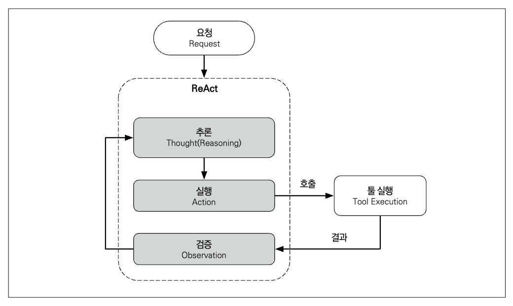
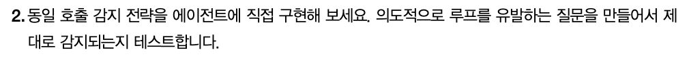
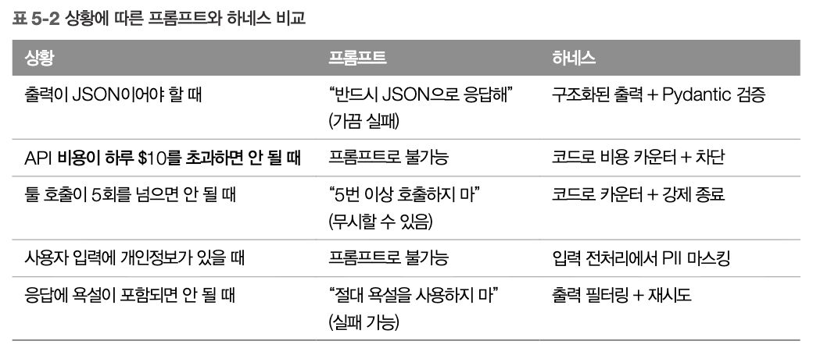
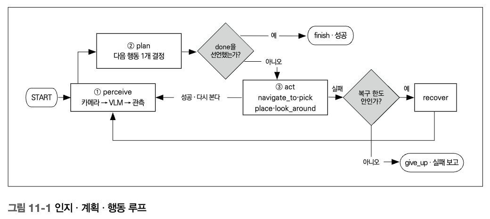

> "한빛미디어 서평단 \<나는리뷰어다\> 활동을 위해서 책을 협찬 받아 작성된 서평입니다."

## 목차

1. [익숙한 개념을 다시 읽었는데도 좋았던 이유](#reading)
2. [4부 14장 한눈에 보기 - 원리에서 운영까지](#structure)
3. [꼼꼼한 설명 - 원리와 구현을 함께 보여준다](#detail)
4. [실전 프로젝트 - 배운 구조를 다른 문제에 적용한다](#projects)
5. [정리 - 개념과 구현을 연결하고 싶은 개발자에게](#wrap-up)

---

## 익숙한 개념을 다시 읽었는데도 좋았던 이유 {#reading}

최근 [『처음 만드는 AI 에이전트 서비스』](/first-ai-agent-service/)와 [『일하는 AI 에이전트, 설계하는 사람』](/working-ai-agents-human-designers/) 등을 읽으며 툴 호출, 메모리, RAG 같은 개념을 여러 번 접했다. 평소에도 AI로 코드를 살펴보고, 반복하는 작업은 스킬로 정리해 사용하고 있다.

그래서 [『하네스 엔지니어링으로 완성하는 에이전틱 AI』](https://www.hanbit.co.kr/books/B6778254847?code=B6778254847)의 앞부분에는 익숙한 내용도 있었다. 이전에 읽은 책들 덕분에 용어에서 오래 멈추지 않고 읽을 수 있었던 것 같다.

특히 좋았던 것은 **설명이 꼼꼼하고, 앞에서 이해한 내용이 다음 구현으로 자연스럽게 이어진다는 점**이었다. 다루는 내용이 많아도 지금 배우는 것이 어디에 쓰이는지 알 수 있어 따라가기 편했다.

---

## 4부 14장 한눈에 보기 - 원리에서 운영까지 {#structure}

420쪽에 4부 14장. 저자는 고돈호다.

| 파트 | 장 | 다루는 내용 |
| --- | --- | --- |
| **Part 1 에이전트의 핵심 원리** | 1~5장 | 툴 사용, ReAct, 메모리, 컨텍스트와 하네스 |
| **Part 2 에이전트 확장하기** | 6~8장 | RAG, 랭그래프 워크플로, 멀티 에이전트 |
| **Part 3 실전 프로젝트** | 9~11장 | 시장 브리핑, 자기수정 데이터 분석가, 멀티모달 집사 로봇 |
| **Part 4 프로덕션과 운영** | 12~14장 | 보안, 로컬 모델 서빙, 배포와 모니터링 |

**작은 에이전트의 원리 → 필요한 기능의 확장 → 프로젝트에 적용 → 운영**으로 이어진다.

프로젝트를 만든 뒤에는 보안과 비용, 배포 이후의 기록까지 살핀다.

---

## 꼼꼼한 설명 - 원리와 구현을 함께 보여준다 {#detail}

예를 들어 ReAct는 에이전트가 추론하고, 도구를 실행하고, 결과를 확인하며 다음 행동을 정하는 반복 구조다. 책은 먼저 그림과 간단한 요청으로 이 흐름을 설명한다.

<figure>
  
  <figcaption>출처: 『하네스 엔지니어링으로 완성하는 에이전틱 AI』 31쪽, 그림 1-4.</figcaption>
</figure>

3장에서는 이 구조를 직접 구현한 뒤, 랭그래프를 사용하는 방식으로 이어간다. **프레임워크가 대신해주는 일을 앞의 구현과 비교할 수 있어서, 코드의 역할을 이해하기 편했다.**

각 장 끝의 **연습문제도 좋았다.** 아래 문제처럼 예제에 새 조건을 적용하려면 어디를 바꿔야 할지 생각하게 된다. 읽은 내용을 한 번 더 되짚을 수 있다는 점이 마음에 들었다.

<figure>
  
  <figcaption>출처: 『하네스 엔지니어링으로 완성하는 에이전틱 AI』 96쪽, 3장 연습문제 2번.</figcaption>
</figure>

하네스도 구체적인 상황으로 설명한다. 출력 형식을 지켜야 할 때, 도구 호출 횟수를 제한해야 할 때, 비용 상한을 정해야 할 때 어떤 처리가 필요한지 나눠서 보여준다.

<figure>
  
  <figcaption>출처: 『하네스 엔지니어링으로 완성하는 에이전틱 AI』 140쪽, 표 5-2.</figcaption>
</figure>

이렇게 상황을 나눠 보여주니 ‘하네스를 설계한다’는 말이 구체적으로 읽혔다. 모델에 맡길 판단과 코드로 검사할 조건을 구분해 생각해볼 수 있었다.

---

## 실전 프로젝트 - 배운 구조를 다른 문제에 적용한다 {#projects}

시장 브리핑 에이전트는 수집·정리·전송의 순서가 정해져 있어서 선형 워크플로로 구성한다. 앞에서 배운 여러 패턴 중 **이 상황에 왜 그 구조가 맞는지** 설명해주는 점이 좋았다.

데이터 분석가 프로젝트에서는 코드를 생성하고 실행한 뒤, 오류나 검토 결과에 따라 다시 고치는 순환을 만든다. 집사 로봇 프로젝트에서는 물리 시뮬레이터 안의 상황을 이미지로 보고, 다음 행동을 정하고, 행동한 뒤 다시 관찰한다.

<figure>
  
  <figcaption>출처: 『하네스 엔지니어링으로 완성하는 에이전틱 AI』 319쪽, 그림 11-1.</figcaption>
</figure>

같은 반복 구조여도 분석가는 오류를 고치기 위해 돌아가고, 로봇은 행동 후 달라진 상황을 다시 보기 위해 돌아간다. 이렇게 비교하니 앞에서 배운 원리가 프로젝트마다 어떻게 달라지는지 이해하기 쉬웠다.

프로젝트가 시나리오와 성공·실패 기준을 정하는 데서 시작해 구현과 평가까지 이어지는 것도 마음에 들었다. 코드를 읽으면서도 어떤 결과를 완료로 볼지, 어디까지 다시 시도할지 함께 생각하게 됐다.

---

## 정리 - 개념과 구현을 연결하고 싶은 개발자에게 {#wrap-up}

AI 관련 책을 읽어 개념은 어느 정도 익숙하지만, 그것들을 어떤 순서로 구현하고 연결하는지 정리하고 싶은 개발자에게 권하고 싶다. 파이썬 코드와 함께 작은 에이전트에서 프로젝트까지 따라가고 싶을 때도 잘 맞겠다.

내게는 **이미 알던 개념을 구현 관점에서 다시 정리하기 좋은 책**이었다. 원리부터 프로젝트까지 이어지는 구성과 중간중간 되짚게 하는 연습문제가 함께 있어 알차게 읽었다.

피드백은 언제나 환영입니다.
